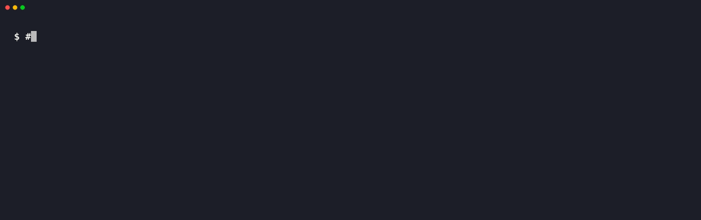

<div align="center">

<h1>
  <picture>
    <source media="(prefers-color-scheme: dark)" srcset="https://raw.githubusercontent.com/dinhkarate/keyshroud/main/assets/brand/lockup-dark.svg">
    
  </picture>
</h1>

**エージェントはキーを使える。でも、キーを見ることはない。**

**Claude Code、Codex、Cursor、Cline、OpenCode、Gemini CLI、pi、omp から API キーを遠ざける** —
シークレットはセルフホストした [Vaultwarden](https://github.com/dani-garcia/vaultwarden)（または Bitwarden）に保管され、
モデルが読む前にすべての値がマスクされます。

[](https://www.npmjs.com/package/keyshroud)
[](https://www.npmjs.com/package/keyshroud)
[](../LICENSE)

[🚀 クイックスタート](#クイックスタート) · [🔐 Vault のセットアップ](../examples/vaultwarden#readme) · [🔌 対応エージェント](#対応エージェント) · [❓ よくある質問](#よくある質問) · [🌐 Web サイト](https://keyshroud.dev)

[🇬🇧 English](../README.md) · [🇻🇳 Tiếng Việt](README.vi.md) · [🇨🇳 简体中文](README.zh-CN.md) · [🇯🇵 日本語](README.ja-JP.md)

</div>

<p align="center"></p>

```console
$ keyshroud run --mask -- sh -c 'echo "deploying with $GH_TOKEN"; gh api user -q .login'
deploying with <redacted:GH_TOKEN>
dinhkarate
```

コマンドには本物のトークンが渡ります。トランスクリプト（とそれを読むモデル）に届くのは `<redacted:GH_TOKEN>` だけです。
（エージェントがコマンドを実行する場合は自動でマスクされます。人が操作するターミナルでは `--mask` で強制できます。）

## なぜ keyshroud？

コーディングエージェントが実際の作業をするには認証情報が必要です。`gh`、`npm publish`、クラウドの CLI、Webhook、データベースなど。よくあるやり方はどれも問題があります。

- ❌ **キーをチャットに貼り付ける** — トランスクリプト、プロバイダーのログ、この先のすべてのコンテキストウィンドウに残ります
- ❌ **`.env` に置く** — エージェントがデバッグ中に `cat` したり、うっかりコミットしたりします
- ❌ **有料のシークレットマネージャーを使う** — `op run` には 1Password のサブスクリプションが必要で、「エージェント向け vault」の多くはホスト型の SaaS です
- ❌ **vault の MCP サーバーを使う** — ほとんどが平文の値をそのままモデルに返します

**keyshroud ならこう解決します：**

- ✅ **値ではなく名前** — エージェントに見えるのは `GH_TOKEN` と `bw://GitHub CLI token` だけで、トークンそのものは見えません
- ✅ **出力のマスク** — stdout/stderr に出た値はすべて `<redacted:GH_TOKEN>` に置き換わります
- ✅ **自分の vault** — $5 の VPS や Raspberry Pi 上の Vaultwarden、または Bitwarden。私たちのサービスのアカウントは不要です
- ✅ **無料** — MIT ライセンス、テレメトリなし

## 対応エージェント

| エージェント | インストール | 使える機能 |
|---|---|---|
| **Claude Code** | [プラグイン](#claude-code) | SessionStart + PostToolUse のマスク用フック、MCP ツール、スキル |
| **pi / omp** | [`pi install npm:keyshroud`](../README.md#pi--omp) | 環境変数への注入、`tool_result` のマスク（失敗した呼び出しも含む）、`/secret` |
| **Codex** | [`codex mcp add keyshroud -- keyshroud mcp`](#任意の-mcp-クライアント) | 出力がマスクされる MCP ツール |
| **Cursor, Claude Desktop, Cline, Gemini CLI** | [`mcpServers` JSON](#任意の-mcp-クライアント) | 出力がマスクされる MCP ツール |
| **OpenCode** | [`opencode mcp add keyshroud -- keyshroud mcp`](#任意の-mcp-クライアント) | 出力がマスクされる MCP ツール |
| **任意のシェルや CI** | `keyshroud run -- <cmd>` | 環境変数の注入 + 出力のマスク |

## クイックスタート

**必要なもの：** Node.js ≥ 22.18、Bitwarden CLI、そして vault。

**0. vault を用意する**（どちらか一方）：

- **Vaultwarden をセルフホスト**（無料、自分のサーバー）：[examples/vaultwarden](../examples/vaultwarden#readme) の手順に従います。
  Docker Compose + Caddy で HTTPS は自動。空の VPS から `keyshroud doctor` まで、バックアップとハードニングも含みます（英語のガイド）。
- **Bitwarden クラウド**（無料アカウント、サーバー不要）：[bitwarden.com](https://bitwarden.com) で登録し、
  下の `bw config server` は飛ばします（EU アカウント：`bw config server https://vault.bitwarden.eu`）。

```bash
npm install -g keyshroud @bitwarden/cli    # または：brew install bitwarden-cli

# 1. bw を自分のサーバーに向けて、一度だけログインする
bw config server https://vault.example.com
bw login

# 2. 30 分間アンロック（マスターパスワードを尋ねる。keyshroud は何も保存しない）
keyshroud unlock

# 3. 全体をチェック
keyshroud doctor

# .env がある場合：`keyshroud import`（ドライラン、名前のみ表示）→ `keyshroud import --yes` で .env.refs を作成
# 4. シークレットを保存 — マスクされたプロンプトに入力し、画面には表示されない
keyshroud add --env GH_TOKEN --item "GitHub CLI token" --notes "gh for agents"

# 5. 使う
keyshroud run -- gh auth status
keyshroud run -- claude          # 紐付けたシークレットをすべて使える状態でエージェントを起動
```

任意：*Settings → Security → Keys → API key* で取得した `vaultwarden-api-client-id` /
`vaultwarden-api-client-secret` もキーチェーンに入れておくと、`bw` のセッションが切れたときに
keyshroud が自動で再ログインします。

### Claude Code

CLI をインストールしてから、プラグイン（MCP サーバー + マスク用フック + スキル）を入れます。

```bash
npm install -g keyshroud
```
```text
/plugin marketplace add dinhkarate/keyshroud
/plugin install keyshroud@keyshroud
```

**制限**：コマンドが**失敗**すると Claude Code は `PostToolUseFailure` を発火しますが、このフックでは出力を書き換えられません。
そのため、スキルとセッションのコンテキストで、シークレットを使うコマンドはすべて `keyshroud run`（または `secrets_run`）経由で実行するよう Claude に指示しています。こちらは終了コードに関係なくプロセス内でマスクします。

### 任意の MCP クライアント

Codex、Cursor、Claude Desktop、Cline、Gemini CLI など、stdio で MCP を話すクライアントならどれでも使えます。

```json
{ "mcpServers": { "keyshroud": { "command": "keyshroud", "args": ["mcp"] } } }
```

Codex：`codex mcp add keyshroud -- keyshroud mcp`。非対話の `codex exec` は承認が必要な MCP 呼び出しを拒否するため、keyshroud のツールを明示的に許可します：

```toml
# ~/.codex/config.toml
[mcp_servers.keyshroud.tools.secrets_run]
approval_mode = "approve"
```
OpenCode：`opencode mcp add keyshroud -- keyshroud mcp`。

ツール：`secrets_list`、`secrets_run`、`secrets_request`、`vault_status`。値を返すツールは一つもありません。

## よくある質問

**Vaultwarden は必須？** いいえ。公式の Bitwarden クラウドでも動きます。keyshroud は `bw` に設定されているサーバーと通信します。

**シークレットはマシンの外に出る？** `bw` と自分の vault サーバーの間だけです。keyshroud にはバックエンドがなく、テレメトリも送りません。値は実行するコマンドの環境変数に渡されるだけです。

**それでもエージェントはキーを使える？** はい。コマンドには本物の値が渡り、マスクされるのはモデルが読むテキストだけです。

**これはサンドボックス？** いいえ。防げるのは*うっかり*の漏洩です。悪意のある、あるいはプロンプトインジェクションを受けたエージェントは、自分が使える値を外部に持ち出せてしまいます — [セキュリティモデル](../README.md#security-model)を参照してください。

**`.env` を `.gitignore` に入れるだけではダメ？** それで防げるのはコミットであって、読み取りではありません。エージェントはデバッグのために `.env` を読み、読んだ内容はモデルのプロバイダーに送られます。

**Windows で動く？** まだテストしていません。macOS と Linux をサポートしています。

## ドキュメント全文

CLI リファレンス、`bw://` 参照の構文、設定用の環境変数、詳しいセキュリティモデルは[英語版 README](../README.md) を参照してください。

## ライセンス

[MIT](../LICENSE) © 2026 dinhkarate
