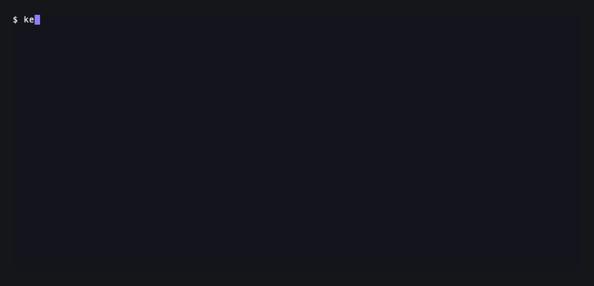

<div align="center">

<h1>
  <picture>
    <source media="(prefers-color-scheme: dark)" srcset="https://raw.githubusercontent.com/dinhkarate/keyshroud/main/assets/brand/lockup-dark.svg">
    
  </picture>
</h1>

**Agent dùng được key. Nhưng không bao giờ nhìn thấy key.**

**Giữ API key ngoài tầm mắt của Claude Code, Codex, Cursor, Cline, OpenCode, Gemini CLI, pi và omp** —
secret nằm trong một vault mã hoá ngay trên máy bạn (hoặc trong [Vaultwarden](https://github.com/dani-garcia/vaultwarden)
tự host / Bitwarden, nếu muốn dùng chung giữa nhiều máy), và mọi giá trị đều bị che trước khi model đọc được.

[](https://www.npmjs.com/package/keyshroud)
[](https://www.npmjs.com/package/keyshroud)
[](../LICENSE)

[🚀 Bắt đầu nhanh](#bắt-đầu-nhanh) · [🔐 Vault cục bộ](#vault-cục-bộ) · [🔄 Đồng bộ với Vaultwarden](#đồng-bộ-nhiều-máy-vaultwarden-hoặc-bitwarden) · [🔌 Agent được hỗ trợ](#agent-được-hỗ-trợ) · [❓ Hỏi đáp](#hỏi-đáp) · [🌐 Website](https://keyshroud.dev)

[🇬🇧 English](../README.md) · [🇻🇳 Tiếng Việt](README.vi.md) · [🇨🇳 简体中文](README.zh-CN.md) · [🇯🇵 日本語](README.ja-JP.md)

</div>

<p align="center"></p>

```console
$ keyshroud run --mask -- sh -c 'echo "deploying with $GH_TOKEN"; gh api user -q .login'
deploying with <redacted:GH_TOKEN>
dinhkarate
```

Lệnh nhận token thật. Transcript — và model đọc transcript — chỉ thấy `<redacted:GH_TOKEN>`.

## Vì sao cần keyshroud?

Agent cần credential để làm việc thật: `gh`, `npm publish`, CLI của cloud, webhook, database. Các cách thường dùng đều dở:

- ❌ **Dán key vào chat** — key nằm luôn trong transcript, log của nhà cung cấp, và mọi context về sau
- ❌ **Để trong `.env`** — agent `cat` file khi debug, hoặc commit nhầm
- ❌ **Trả tiền cho secrets manager** — `op run` cần gói 1Password, còn phần lớn "agent vault" là SaaS
- ❌ **Dùng MCP server của vault** — đa số trả thẳng plaintext cho model

**keyshroud giải quyết:**

- ✅ **Tên, không phải giá trị** — agent chỉ thấy `GH_TOKEN` và `local://GitHub token`
- ✅ **Che output** — giá trị nào lọt ra stdout/stderr đều thành `<redacted:GH_TOKEN>`
- ✅ **Không phải cài gì thêm** — một file vault mã hoá, khoá nằm trong keychain của hệ điều hành; không tài khoản, không server
- ✅ **Đồng bộ nếu muốn** — Vaultwarden trên VPS $5 hay Raspberry Pi, hoặc Bitwarden, cho nhiều máy
- ✅ **Miễn phí** — MIT, không telemetry

## Agent được hỗ trợ

| Agent | Cài đặt | Có gì |
|---|---|---|
| **Claude Code** | plugin (xem bên dưới) | hook che output SessionStart + PostToolUse, skill |
| **pi / omp** | `pi install npm:keyshroud` | nạp env, che `tool_result` (cả lệnh lỗi), `/secret` |
| **Codex, OpenCode, Gemini CLI, Cursor agent** | [`npx skills add dinhkarate/keyshroud`](../README.md#other-agents-with-a-shell) | skill + CLI, output đã che |
| **Claude Desktop, client chỉ chat** | [JSON `mcpServers`](../README.md#mcp-clients-without-a-shell) | MCP tools, output đã che |
| **Shell hoặc CI bất kỳ** | `keyshroud run -- <cmd>` | inject env + che output |

## Bắt đầu nhanh

**Cần:** Node.js ≥ 22.18. Ngoài ra không cần gì: không tài khoản, không server.

```bash
npm install -g keyshroud

# 1. Lưu secret — gõ vào prompt có che, không hiện ra màn hình.
#    Secret đầu tiên sẽ tạo vault cục bộ.
keyshroud add --env GH_TOKEN --item "GitHub token"

# 2. Dùng
keyshroud run -- gh auth status
keyshroud run -- claude          # chạy agent với mọi secret đã nối

# 3. Kiểm tra
keyshroud doctor
```

Không có terminal (shell của agent) thì `add` mở hộp thoại nhập ẩn trên desktop, nên agent có thể
chạy lệnh còn bạn chỉ việc dán. Đã có `.env`? `keyshroud import` (chạy thử, chỉ in tên) rồi
`keyshroud import --yes` → `.env.refs`.

### Vault cục bộ

`~/.config/keyshroud/vault.json` chứa mọi item, mã hoá AES-256-GCM bằng một khoá 256-bit ngẫu nhiên
(cả tên item cũng được mã hoá). Khoá nằm ở đâu tuỳ máy:

| Máy | Khoá | Mở khoá |
|---|---|---|
| macOS | login keychain, mục `keyshroud-vault-<id>` | không cần |
| Linux có keyring desktop và systemd | Secret Service (`secret-tool`; dò bằng `busctl`) | không cần |
| Windows | DPAPI, gắn với tài khoản Windows của bạn | không cần |
| Docker, server, SSH với keyring bị khoá, Linux không có systemd | sinh từ passphrase (scrypt) | `keyshroud unlock`; session hết hạn sau 30 phút |

Muốn luôn được hỏi passphrase thì tạo vault bằng `KEYSHROUD_VAULT_KEY=passphrase keyshroud unlock`
trong terminal (gõ hai lần, ít nhất 12 ký tự). Mất khoá hay quên passphrase thì không có cách khôi phục,
và vault chỉ thuộc về một máy; muốn sao lưu hoặc dùng nhiều máy, hãy dùng Vaultwarden hoặc Bitwarden.

### Đồng bộ nhiều máy: Vaultwarden hoặc Bitwarden

- **Tự host Vaultwarden** (miễn phí, server của bạn): làm theo
  [examples/vaultwarden](../examples/vaultwarden#readme) — Docker Compose + Caddy có HTTPS tự động,
  từ VPS trống tới `keyshroud doctor`, kèm backup và hardening (hướng dẫn bằng tiếng Anh).
- **Bitwarden cloud** (tài khoản miễn phí, không cần server): đăng ký ở [bitwarden.com](https://bitwarden.com)
  và bỏ qua `bw config server` bên dưới (tài khoản EU: `bw config server https://vault.bitwarden.eu`).

```bash
npm install -g @bitwarden/cli

# 1. Trỏ bw vào server và đăng nhập một lần
bw config server https://vault.example.com
bw login

# 2. Từ giờ item mới vào Vaultwarden (item local:// vẫn dùng được)
mkdir -p ~/.config/keyshroud && echo bw > ~/.config/keyshroud/backend

# 3. Mở khoá 30 phút (hỏi master password; keyshroud không lưu gì)
keyshroud unlock
```

Máy đã dùng keyshroud 0.7 (có `bw` đăng nhập, file của keyshroud, hoặc master password trong keychain)
vẫn giữ Vaultwarden làm mặc định; không cần làm gì. Tham chiếu `local://…` và `bw://…` dùng song song được.

### Claude Code

```bash
npm install -g keyshroud
```
```text
/plugin marketplace add dinhkarate/keyshroud
/plugin install keyshroud@keyshroud
```

Lưu ý: khi một lệnh **lỗi**, Claude Code gọi `PostToolUseFailure`, hook này không sửa được output.
Vì vậy mọi lệnh dùng secret nên chạy qua `keyshroud run` (hoặc `secrets_run`) — lệnh đó tự che bất kể exit code.

### MCP client bất kỳ

```json
{ "mcpServers": { "keyshroud": { "command": "keyshroud", "args": ["mcp"] } } }
```

OpenCode: `opencode mcp add keyshroud -- keyshroud mcp`.

Codex: `codex mcp add keyshroud -- keyshroud mcp`. Chế độ `codex exec` (không tương tác) từ chối lệnh MCP cần duyệt; cho phép tool của keyshroud:

```toml
# ~/.codex/config.toml
[mcp_servers.keyshroud.tools.secrets_run]
approval_mode = "approve"
```

Các tool: `secrets_list`, `secrets_run`, `secrets_request`, `vault_status`. Không tool nào trả về giá trị.

## Hỏi đáp

**Có bắt buộc Vaultwarden không?** Không. Mặc định secret nằm trong một file mã hoá trên máy bạn.
Vaultwarden (hoặc Bitwarden cloud chính hãng) là tuỳ chọn, để dùng cùng secret trên nhiều máy hoặc có bản lưu trên server.

**Secret có ra khỏi máy không?** Với vault cục bộ thì không. Với Vaultwarden hoặc Bitwarden, chỉ đi giữa `bw` và server
của bạn. keyshroud không có backend riêng, không telemetry.

**Tôi đang dùng keyshroud 0.7, có gì thay đổi?** Không gì cả: máy có `bw` đăng nhập, file của keyshroud, mục `bw://` hay
`!bw` trong auth.json, `BW_SESSION`, hoặc master password trong keychain vẫn dùng Vaultwarden, và lựa chọn đó được ghi
vào `~/.config/keyshroud/backend`.

**Agent vẫn dùng được key chứ?** Được. Lệnh nhận giá trị thật; chỉ phần chữ model đọc là bị che.

**Đây có phải sandbox không?** Không. Nó chặn rò rỉ *vô tình*. Agent độc hại hoặc bị prompt injection vẫn có thể gửi giá trị ra ngoài — xem [security model](../README.md#security-model).

**Chạy trên Windows được không?** Được, đã test trên Windows 10 với Node 22: vault cục bộ giữ khoá bằng DPAPI, gắn với tài khoản Windows của bạn. Với Vaultwarden, hộp thoại mở khoá là một cửa sổ PowerShell nhỏ, session vẫn hết hạn sau 30 phút, và vì Windows không có keychain cho master password nên keyshroud luôn hỏi nó. Xem thêm [FAQ tiếng Anh](../README.md#faq).

**Ai đọc được vault cục bộ?** Chương trình nào chạy dưới tài khoản của bạn cũng đọc được khoá trong keychain, kể cả agent, nên ở chế độ này keyshroud không hỏi trước khi mở vault. Muốn được hỏi thì tạo vault bằng passphrase (`KEYSHROUD_VAULT_KEY=passphrase`). Chi tiết ở [security model](../README.md#security-model).

## Tài liệu đầy đủ

CLI reference, cú pháp `local://` và `bw://`, biến cấu hình và security model chi tiết nằm ở [README tiếng Anh](../README.md).

## License

[MIT](../LICENSE) © 2026 dinhkarate
